# Assignment 3 Report

This report covers the network setup (Part A), our TCP over raw sockets (Part B), the HTTP client (Part C) and the HTTP server (Part D). Every screenshot was taken on our four Ubuntu 22.04 VMs (UTM on an Apple Silicon Mac) and shows the command that produced it.

## Overview

The four parts build one small system from the bottom up: a network, a TCP stack, and a web client and server on top.

- **Part A (network):** four VMs with hand-set addresses and routes, so requests and replies take different paths.
- **Part B (TCP):** our own IPv4 and TCP on raw sockets, with retransmission, reordering and congestion control.
- **Part C (client):** `client.py` sends one HTTP GET request, reads the reply, and saves the body.
- **Part D (server):** `server.py` serves files from a folder to tools like curl and wget.
- Both use `custom_http.py` for HTTP work (building and reading requests and replies).
- Both use `custom_socket.py` for TCP (our Part B code), so no kernel TCP and no HTTP libraries are used.
- Client and server always run on different machines.

## Part A: the network

Four VMs form a chain (client, r1, r2, server) plus a second direct link between the client and r2, so requests and replies take different paths.

### Addresses and roles

| Machine | Role | Interfaces |
| --- | --- | --- |
| client | host | LAN A `10.10.1.10/24` (enp0s8), Link D `10.10.4.2/30` (enp0s9) |
| r1 | router | LAN A `10.10.1.1/24` (enp0s8), LAN B `10.10.2.1/24` (enp0s9) |
| r2 | router | LAN B `10.10.2.2/24` (enp0s8), LAN C `10.10.3.1/24` (enp0s9), Link D `10.10.4.1/30` (enp0s10) |
| server | host | LAN C `10.10.3.10/24` (enp0s8) |

### R1: network adapters

Each VM is attached only to its own internal networks (no NAT adapter). Before running our scripts, every interface is down and has no address.

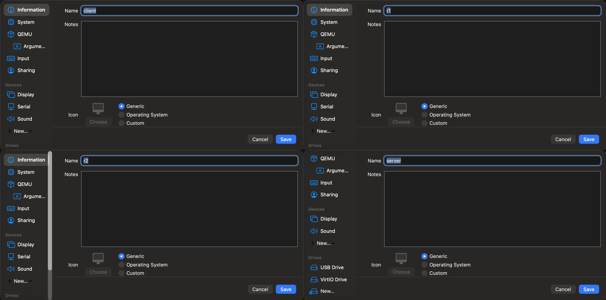

*What it shows:* UTM's settings window for client, r1, r2 and server. The **Devices** list of every VM has no **Network** device, so UTM gives none of them a NAT, shared or bridged network. The VMs have no Internet and no link to the host computer. The only network cards are the internal links (LANs A, B, C and Link D), which we add through the QEMU **Arguments** page.

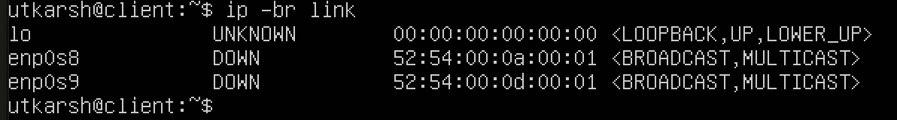
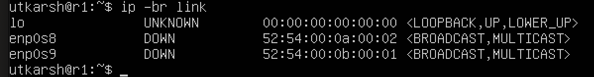
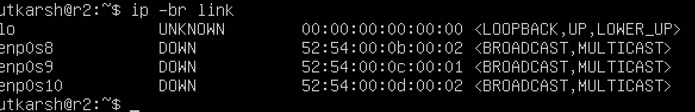
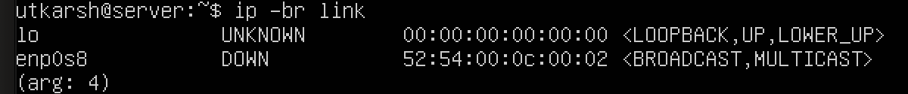

*What it shows:* `ip -br link` on each VM before setup. The client and server have the right number of interfaces (2 and 1), r1 has 2 and r2 has 3, and all are DOWN. The middle part of each MAC address shows which network the card is on: `0a` = LAN A, `0b` = LAN B, `0c` = LAN C, `0d` = Link D. For example, the client's cards end in `0a:00:01` and `0d:00:01`, so it sits on LAN A and Link D.

### Routes each script sets up

Adding an address with `ip addr add` creates the route for that network automatically. Only the routes below are added by hand.

| Machine | Route added | Why |
| --- | --- | --- |
| client | `10.10.2.0/24` via `10.10.1.1` (r1) | Requests to LAN B go through r1 |
| client | `10.10.3.0/24` via `10.10.1.1` (r1) | Requests to the server go client, r1, r2, server (A2) |
| r1 | default via `10.10.2.2` (r2) | One route covers every network r1 is not attached to (LAN C and Link D) (A5) |
| r2 | `10.10.1.0/24` via `10.10.2.1` (r1) | Lets r2 reach LAN A, including r1's own address |
| r2 | `10.10.1.10/32` via `10.10.4.2` (client) | Sends replies for the client over Link D (A3) |
| server | default via `10.10.3.1` (r2) | Every reply leaves through r2 |

### R1: addresses and routes after running the scripts

Each screenshot shows the same steps: `rp_filter` is 1 everywhere before we start (A7), then our script runs, then `ip -br addr` and `ip route`.

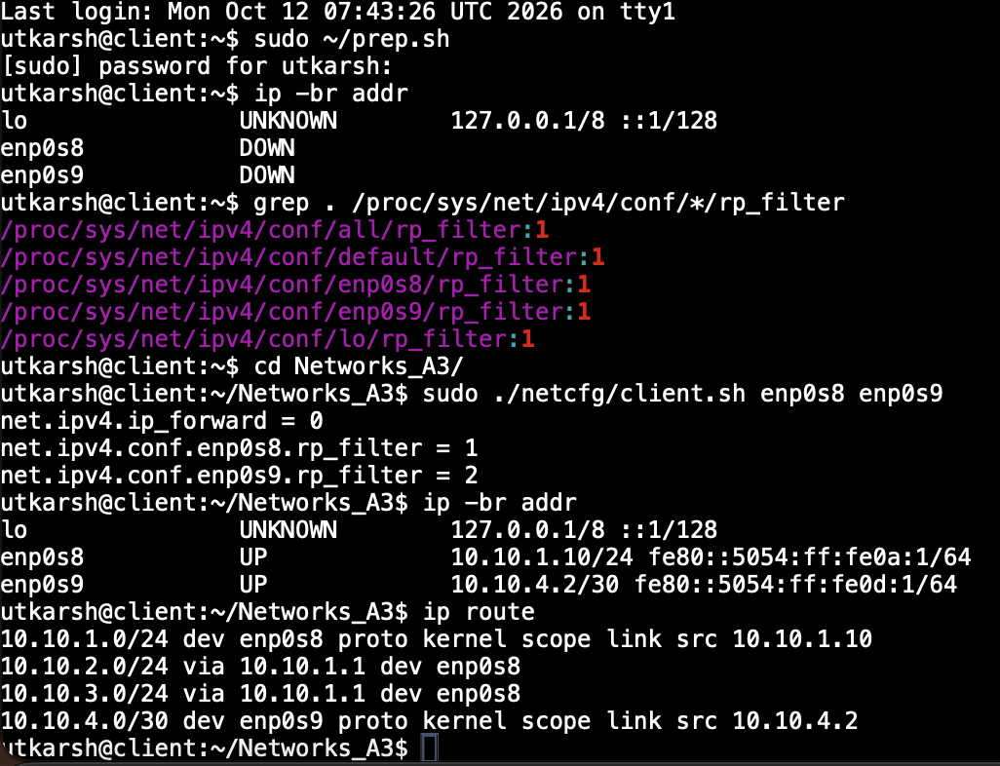

*What it shows:* the client gets `10.10.1.10/24` and `10.10.4.2/30`. LAN B and LAN C are reached through r1 (`10.10.1.1`). There is no default route.

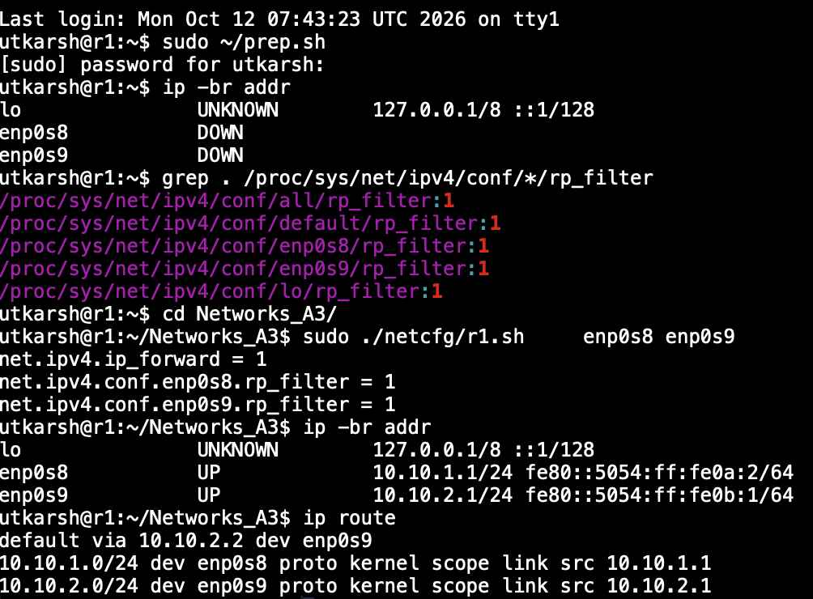

*What it shows:* r1 has its two addresses and one extra route only: `default via 10.10.2.2` (A5). Forwarding is on.

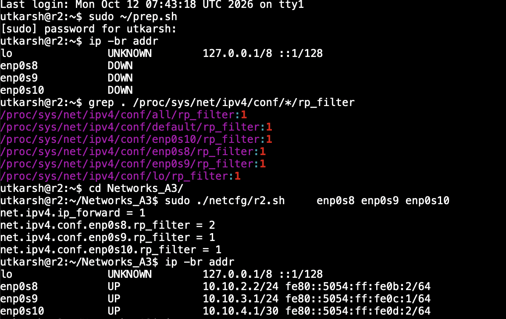
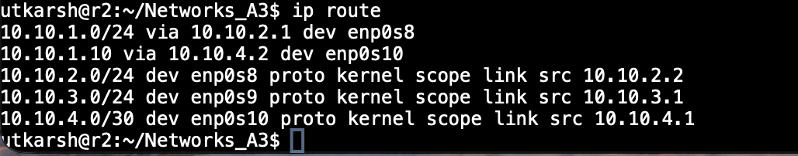

*What it shows:* r2 has its three addresses. It has the `/24` route to LAN A through r1 and the `/32` route to the client over Link D. There is no default route (A6).

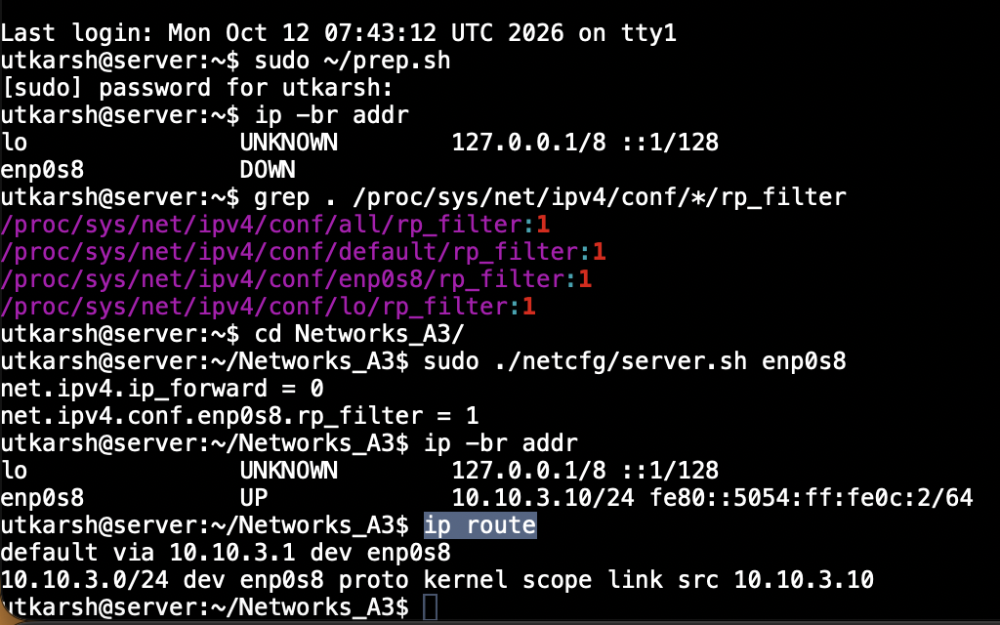

*What it shows:* the server gets `10.10.3.10/24` and one route, `default via 10.10.3.1` (r2). Forwarding is off.

### Why replies take Link D

- r2 has two routes that match the client's address `10.10.1.10`: the `/24` through r1 and the `/32` over Link D.
- Linux always picks the most specific route (longest prefix), so the `/32` wins and the reply goes over Link D.
- Traffic for other LAN A addresses, such as r1's `10.10.1.1`, still goes through r1.
- r1 has no route except its default, and r2 has no default route at all: everything r2 needs is either directly connected or listed above.

### A1 and A4: reachability and forwarding

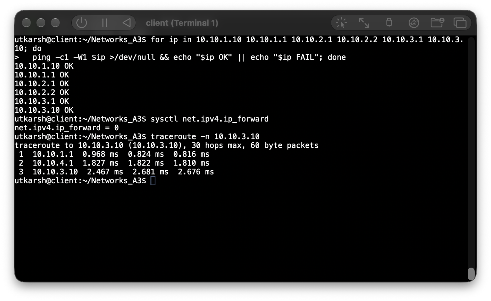
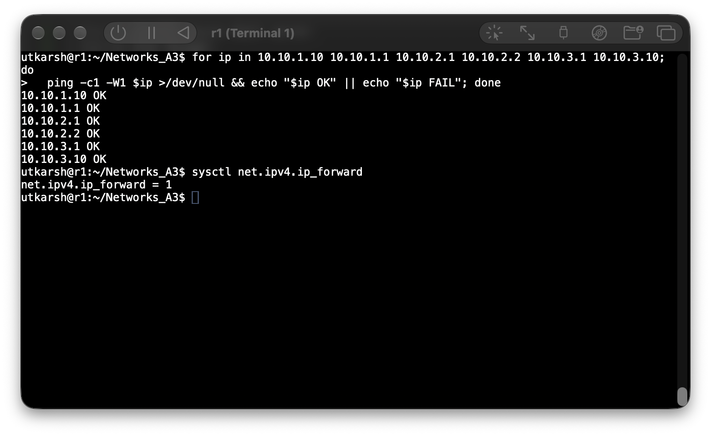
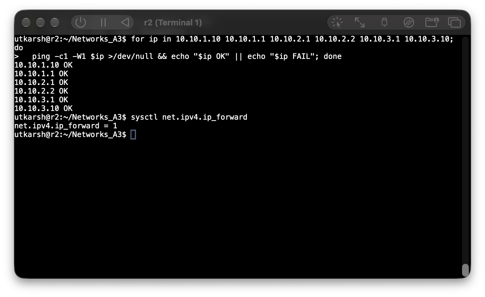
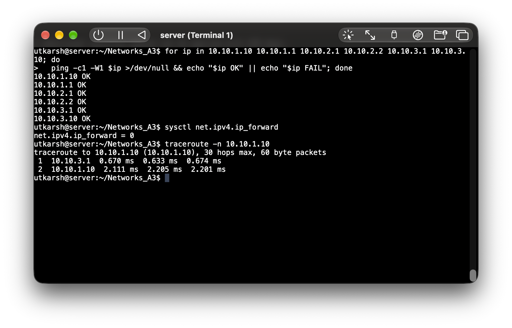

*What it shows:* every machine pings all six addresses on LANs A, B and C, and all of them answer (A1). `ip_forward` is 1 on r1 and r2 and 0 on the client and server (A4).

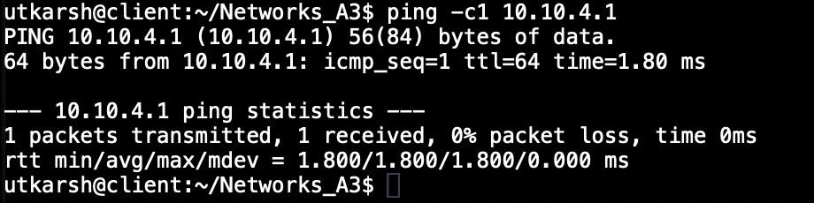
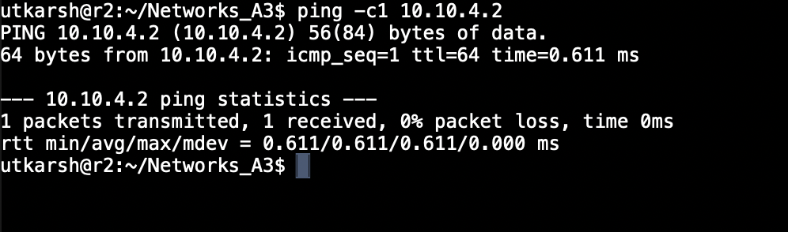

*What it shows:* the client and r2 can reach each other over Link D (`10.10.4.1` and `10.10.4.2`). TTL 64 means no router in between.

### R2: traceroute

The two traceroutes are at the bottom of the client and server screenshots above.

| Direction | Hops |
| --- | --- |
| client to server (`traceroute -n 10.10.3.10`) | 1: `10.10.1.1` (r1), 2: `10.10.4.1` (r2), 3: `10.10.3.10` (server) |
| server to client (`traceroute -n 10.10.1.10`) | 1: `10.10.3.1` (r2), 2: `10.10.1.10` (client) |

- **client to server:** the client's route to LAN C points to r1, so r1 is the first hop. r1's default route sends it to r2, and r2 is directly attached to LAN C.
- **server to client:** the server's default route points to r2. r2's `/32` route sends it straight to the client over Link D, so r1 never appears.
- **Why r2 shows `10.10.4.1` and not `10.10.2.2`:** when r2 says "time exceeded" to the client, it sends that ICMP reply from the address of the interface the reply leaves through. A reply to the client leaves over Link D, so its source is `10.10.4.1`.
- **Why the directions differ:** requests go through r1 (rule A2) and replies go over Link D (rule A3).

### R3: forwarding and reverse-path filtering

- **Forwarding:** `net.ipv4.ip_forward` is 1 on r1 and r2 and 0 on the client and server, so only the routers pass packets on.
- **Why rp\_filter changes:** requests and replies use different paths, so some packets arrive on an interface that is not the best route back to their source. Strict filtering (1) drops those.

| Machine | Interface | Setting | Why |
| --- | --- | --- | --- |
| client | Link D (enp0s9) | loose (2) | Replies from the server arrive over Link D, but the client's route to the server is through r1 |
| r2 | LAN B (enp0s8) | loose (2) | Client packets arrive from r1, but r2's route back to the client is over Link D |
| client, r2 | all other interfaces | strict (1) | Their paths are symmetric, so strict is safe |
| r1, server | all interfaces | strict (1) | Required by the assignment (A7); their paths are symmetric |

The kernel uses the higher of the `all` and per-interface values, so setting 2 on one interface works while `all` stays 1.

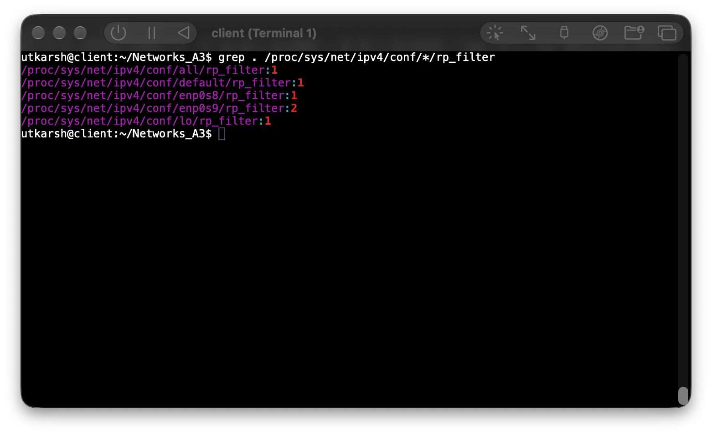
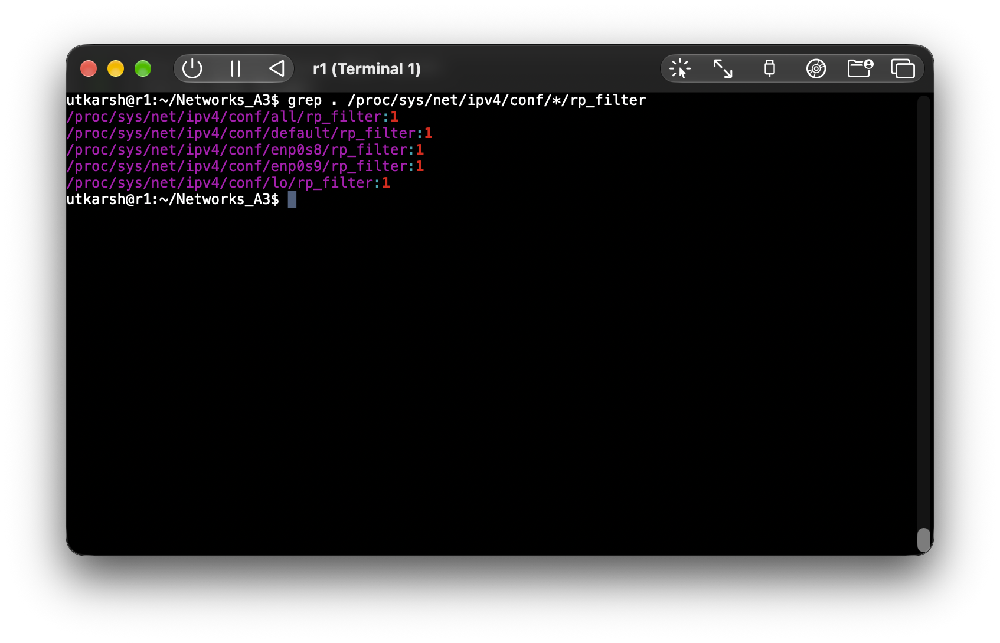
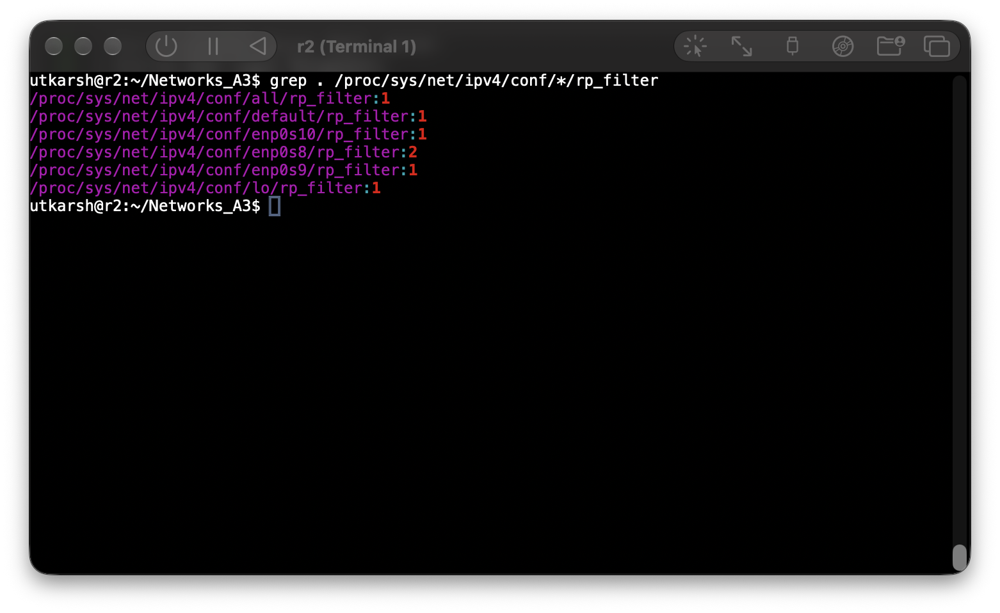
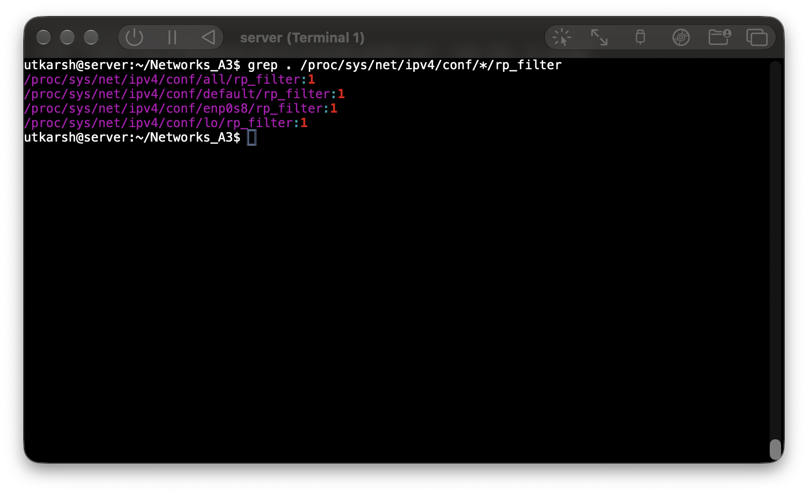

*What it shows:* the final values. Only client enp0s9 (Link D) and r2 enp0s8 (LAN B) are 2. Everything else, including all of r1 and the server, is 1.

**Proof that loose mode is needed:**

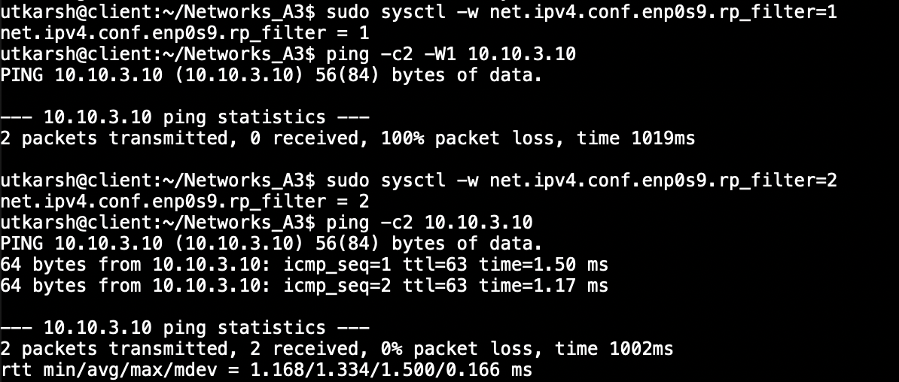

*What it shows:* we set client Link D back to strict (1). The ping to the server fails (100% loss), because the reply comes in on Link D. With 2, the ping works again.

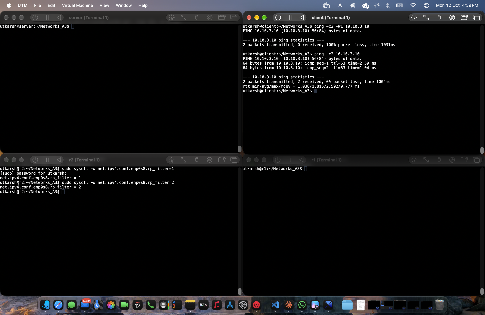

*What it shows:* we set r2 LAN B to strict (1). The client's ping to the server fails, because r2 drops the request coming from r1. With 2, the ping works again.

## Part B: TCP over raw sockets

We build every IPv4 and TCP header ourselves and keep all connection logic in one class.

| File | What it holds | What it does not know |
| --- | --- | --- |
| `ip_header.py` | Internet checksum; builds and checks IPv4 headers (DF flag, ID from 1 to 65535, TTL 64; rejects bad version, lengths, checksum and fragments) | Anything about TCP or connections |
| `tcp.py` | Flag constants; builds and checks TCP headers (checksum with pseudo-header; only the MSS option is sent or read) | Anything about connections |
| `custom_socket.py` | `CustomTCPSocket`: handshake, send, receive, teardown, timers, congestion control, packet log | Header layout: it works with already parsed fields |

### Key variables

A sequence number counts bytes, so these variables mark positions in the byte stream.

| Variable | Meaning |
| --- | --- |
| `snd_una` | Oldest byte sent but not yet acknowledged |
| `snd_nxt` | Next byte to send |
| `snd_max` | Highest byte ever sent (stays ahead of `snd_nxt` after a resend) |
| `rcv_nxt` | Next byte we expect from the peer, and the ACK number we send |
| `cwnd`, `ssthresh` | Congestion window and slow-start threshold, in bytes |
| `rto`, `srtt`, `rttvar` | Retransmission timeout and the round-trip estimates behind it |
| `out_of_order` | Segments that arrived early, stored by sequence number |

Sequence numbers are 32-bit and wrap around, so every comparison uses the helpers `seq_add`, `seq_diff`, `seq_lt` and `seq_le`.

### Connection setup

1. **Client (`connect`):** pick a random source port (61000 to 65535) and find the local address with a UDP socket that sends nothing. Send a SYN with a random initial sequence number and MSS 1460.
2. **Retries:** the SYN is resent every 1 second and the attempt ends after 8 seconds. A RST that acknowledges the SYN means the connection was refused.
3. **Server (`accept`):** wait for a SYN to the listening port on any address, remember who sent it, and reply from the address the SYN was sent to with a SYN-ACK (MSS 1460). The SYN-ACK is resent every 1 second, and at once if the client's SYN repeats.
4. **Finish:** the client acknowledges the SYN-ACK. Both sides then set `mss` to the smaller of 1460 and the peer's MSS (536 if the peer sent none) and start with `cwnd` at 10 segments.

### Sending data

- `send` stores the data and loops until everything is acknowledged, so it returns only when `snd_una` reaches the end.
- `_send_new_data` sends segments of up to one MSS while the data in flight stays below the smaller of `cwnd` and the peer's window. The last segment carries the PSH flag.
- The timer starts when data is sent and restarts on each new ACK.
- If nothing is acknowledged for 10 seconds, `send` raises a timeout.

### Receiving data and reordering

- Every accepted segment goes through `_handle_segment`: a RST aborts, an ACK goes to `_handle_ack`, and data or a FIN goes to `_handle_data`.
- A segment that starts at or before `rcv_nxt` is in order: any part we already have is skipped and the rest is added to the receive buffer.
- A segment ahead of `rcv_nxt` but inside the 65535 window is stored in `out_of_order`. When a gap fills, `_deliver_out_of_order` moves the stored segments into the buffer in order.
- A FIN is only counted once all data before it has arrived.
- Every data segment is answered with a cumulative ACK of `rcv_nxt`, including duplicates and early ones. `recv` hands the buffered bytes to HTTP, or empty bytes after the peer's FIN.

### Loss recovery

- **Timer:** the timeout is measured from round-trip times (RFC 6298 method) and kept between 0.2 and 1 second. It starts at 1 second and doubles after each timeout, never above 1 second.
- **Fair timing:** only one segment is timed at a time, and never a retransmitted one (Karn's rule).
- **Timeout:** the oldest unacknowledged segment is resent and sending restarts from it in slow start.
- **Early resend:** three duplicate ACKs (same ACK number, no data, same window, data outstanding) trigger a resend of the missing segment without waiting for the timer.

### Congestion control

This is Reno with NewReno partial ACKs. Data in flight never exceeds the smaller of the congestion window (`cwnd`) and the peer's window. The table shows what each event does.

| Event | What happens |
| --- | --- |
| Connection starts | cwnd is 10 segments (10 x MSS) |
| ACK while cwnd is below ssthresh (slow start) | cwnd grows by up to one MSS per ACK |
| ACK at or above ssthresh | cwnd grows by MSS x MSS / cwnd, about one MSS per round trip |
| 3 duplicate ACKs | ssthresh becomes half the data in flight (at least 2 MSS), the lost segment is resent, cwnd becomes ssthresh plus 3 MSS |
| Partial ACK during recovery | The next missing segment is resent at once |
| ACK covering everything sent before the loss | cwnd becomes ssthresh and recovery ends |
| Timeout | ssthresh becomes half the data in flight, cwnd becomes 1 MSS, the oldest segment is resent |

### Teardown

- `close` sends a FIN and resends it every timeout until it is acknowledged, while still acknowledging the peer's data and FIN.
- It also waits for the peer's FIN, but gives up after 2 seconds in total. TIME\_WAIT is not used.
- A RST at any point ends the connection at once.

### Raw packets and the log

- **Sending:** `_send_segment` builds the TCP header, then the IP header with the next identification number (1 to 65535, never 0), and sends the packet with `sendto` on a raw socket opened with `IP_HDRINCL`. A failed send is treated like a lost packet.
- **Receiving:** `_receive_packet` reads a raw packet, checks the IP header and then the TCP header (both checksums), and drops bad ones silently. `_next_segment` keeps only packets with our connection's addresses and ports. A 4 MB receive buffer avoids drops during bursts.
- **Log:** `_log` writes one line per segment sent or accepted, in the assignment's format, and flushes after every line. Sockets that use the same log path share one open file, which is how the server logs many connections into one file.
- **Kernel resets:** the kernel does not know about our connection, so when our packets arrive it would answer with a RST and kill the connection. Both launchers add one `iptables` rule that drops outgoing RSTs (only once, `-C` checks first). Running other programs is allowed in the launchers. The `DROP tcp ... flags:0x04/0x04` line seen in later screenshots is this rule being printed.

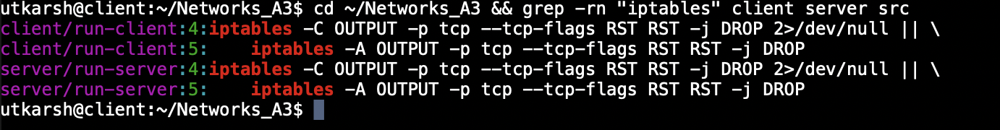

*What it shows:* the only place `iptables` is used is lines 4 and 5 of `run-client` and `run-server`. Our Python code never runs other programs.

<!--
### Requirement map

| Rule | Where it is met |
| --- | --- |
| T1, T2: own IP and TCP headers with checksums, non-zero ID | `create_ip_header`, `create_tcp_header`, ID counter in `_send_segment` |
| T3: SYN option only MSS 1460, data up to the smaller MSS | `_send_segment(mss=...)`, `_established` |
| T4, T5: verify checksums, use only our connection | `parse_ip_header`, `parse_tcp_header`, `_next_segment` |
| T6, T13: random sequence number and source port | `__init__`, `connect` |
| T7: handshake retry and time limit | `HANDSHAKE_RETRY`, `HANDSHAKE_TIMEOUT` |
| T8, T9: RST abort, FIN teardown | `_handle_segment`, `close` |
| T10: window limit, cumulative ACKs, retransmission, 10 second idle limit | `_send_new_data`, `_handle_ack`, `_on_timeout`, `send` |
| T11, T12: in-order delivery, ACK every segment, keep early segments | `_handle_data`, `_deliver_out_of_order` |
| T14: congestion control | `_handle_ack`, `_on_timeout` | -->

### R6: packet capture of one full connection

Our client downloads `small.bin` from our server on port 8080 while `tcpdump` records it on the client.

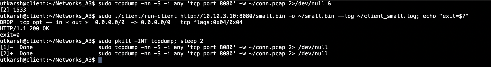

*What it shows:* `tcpdump` starts, our client downloads `small.bin` with `--log`, gets `200 OK` and exit code 0, then `tcpdump` stops.

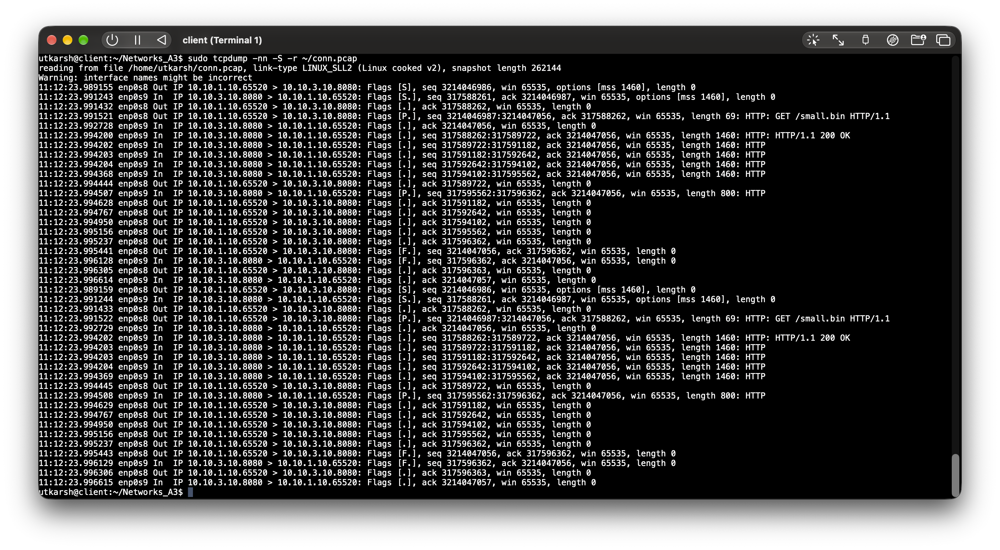

*What it shows:* `tcpdump -nn -S -r ~/conn.pcap`. The first 21 lines are one complete connection (the same 21 lines then repeat, because two old `tcpdump` jobs were writing to the same file; this is a capture mistake, not extra packets):

- **Handshake:** `[S]` with `mss 1460` from random port 65520, `[S.]` with `mss 1460` back, then `[.]`. Both sides advertise window 65535 and send only the MSS option.
- **Request:** one `[P.]` segment of 69 bytes with `GET /small.bin HTTP/1.1`.
- **Data:** six data segments from the server (five of 1460 bytes and the last of 800 with PSH). The first starts with `HTTP/1.1 200 OK`. The client sends a cumulative ACK for every one.
- **Teardown:** the client sends `[F.]`, the server answers with its own `[F.]`, and each side ACKs the other's FIN.
- **Two paths:** packets the client sends leave on `enp0s8` (LAN A, through r1). Packets it receives come in on `enp0s9` (Link D). This is the asymmetric routing from Part A.

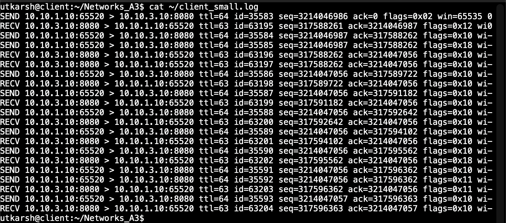

*What it shows:* `cat ~/client_small.log`, our own log of the same connection (same port 65520 and the same sequence numbers as the capture). Each line has the assignment's format.

- **Flags:** SYN `0x02`, SYN-ACK `0x12`, ACK `0x10`, request and last data segment `0x18` (PSH+ACK), FIN `0x11`.
- **IP ID:** our IDs are non-zero and go up by one per packet (35583, 35584, ...).
- **TTL:** we send with 64. Packets from the server arrive with 63, because one router (r2) is on the way back over Link D.
- **Cumulative ACKs:** after each data segment, our ACK number moves forward by 1460 (317589722, 317591182, ...).

The right end of each line (`win`, `len`, `mss`) is cut off by the window width.

### Retransmission under loss

We made r2 drop 5% of the packets it sends to the client over Link D, then downloaded `big.bin` from our server.

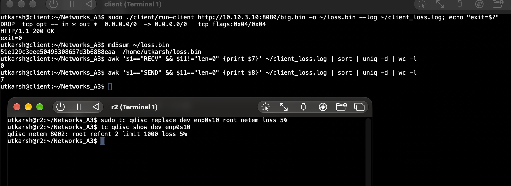

*What it shows:* with `netem loss 5%` on r2, the download still ends with `200 OK`, exit code 0, and the same md5sum as the original (`51e129c3...`). Our log shows the client sent the same ACK number more than once 7 times. These are the duplicate ACKs that tell the server a segment was lost, so it resends it.

### Out-of-order buffering

We made r2 delay packets by 10 ms and send 25% of them early (out of order), then downloaded `big.bin` again.

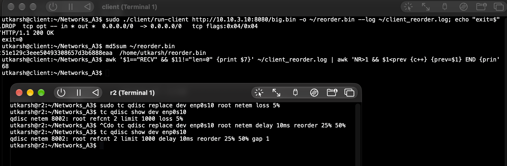

*What it shows:* with `netem delay 10ms reorder 25% 50%`, 68 data segments arrived with a lower sequence number than the one before them, so they were out of order. The file still has the correct md5sum and exit code 0, so early segments were kept and put back in order.

### Fairness with standard TCP

We made a 50 MB file `huge.bin` on the server and served it twice: from our server (port 8080) and from `python3 -m http.server` (port 8000). On r2, we limited Link D to 10 Mbit/s. All data to the client goes over Link D, so this is the shared bottleneck.

*What it shows:* on the server VM, we make the 50 MB test file from random bytes.

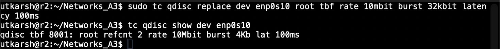

*What it shows:* r2's Link D (enp0s10) is limited to 10 Mbit/s with a token bucket filter (`tbf`).

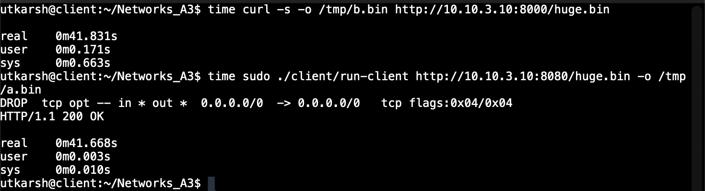

*What it shows:* first, each download runs alone. curl takes 41.8 s and our client takes 41.7 s. Both reach about 9.6 Mbit/s (50 MB in about 42 s), so each one alone fills the link.

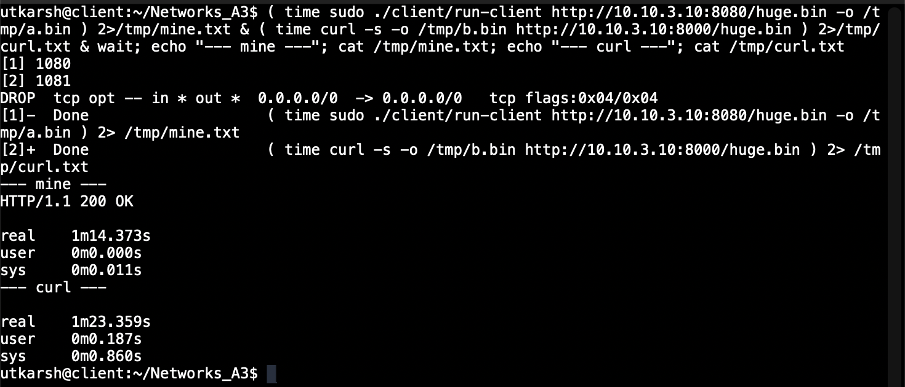

*What it shows:* then both downloads start at the same moment. Our client finishes in 74.4 s and curl in 83.4 s. Both get `200 OK`.

| Run | Our client | curl |
| --- | --- | --- |
| Alone | 41.7 s | 41.8 s |
| Together | 74.4 s | 83.4 s |

**What this means:**
- If the link were split exactly in half, both would take about 83 s (twice the time alone).
- Until our client finished at 74.4 s, the link carried about 89 MB in total: 50 MB for our client and about 39 MB for curl. So our client got about **56%** of the link and curl about **44%**.
- curl then had the link to itself and finished its last 11 MB in about 9 s.
- So the two connections share the link roughly equally. Ours takes a little more, but neither one starves the other. Our cwnd grows when there is room and is halved when packets are dropped at the bottleneck, just like curl's kernel TCP.

Notes on this test:
- We tested one connection of each kind. We did not test several of each at the same time.
- In the server pane, `pgrep` lists our server twice. An older copy from the silent-client test was still running. Both downloads still completed with `200 OK`.
- After the test we removed the limit (`sudo tc qdisc del dev enp0s10 root`).

## Code files

Each file belongs to one part; the HTTP files (Parts C and D) sit on the TCP and IP files (Part B).

| File | Part | What it does |
| --- | --- | --- |
| `netcfg/*.sh` | A | One script per VM: brings up interfaces, sets addresses, routes, forwarding and rp\_filter |
| `ip_header.py` | B | Builds and checks IPv4 headers and checksums |
| `tcp.py` | B | Builds and checks TCP headers and checksums |
| `custom_socket.py` | B | Our TCP: handshake, reliable send, receive, teardown, packet log |
| `custom_http.py` | C and D | URL parsing, request and response building, response reading, and the server's accept loop |
| `client.py` | C | Reads the command line, builds the request, calls the connection, writes the body, sets the exit code |
| `server.py` | D | Reads the command line, picks the file to send, chooses the status code and Content-Type |
| `client/run-client`, `server/run-server` | C, D | Add the RST-drop rule, then `exec` the Python program with all arguments |

## How the files stack up

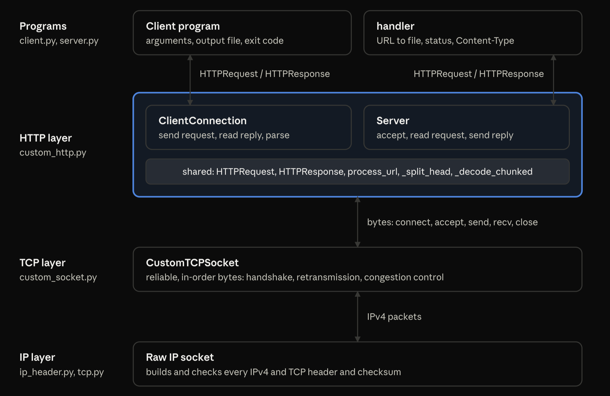

Programs pass request and reply objects to the HTTP layer, the HTTP layer passes plain bytes to our TCP socket, and the socket passes IPv4 packets to the network. Nothing skips a layer, so each one can be explained without the others.

## Classes and what each one does

Each class has one job and is kept unaware of the layers around it. The rows go from the top layer down to the bottom.

| Class or piece | File | Its one job | What it deliberately does not know |
| --- | --- | --- | --- |
| `client.py` (a script, no class) | `client.py` | Reads the command line, builds the request, calls the connection, writes the body, sets the exit code | How bytes are sent or parsed, anything about TCP |
| `handler` | `server.py` | The website logic: turns a request into a file and a status (200, 403, 404, 501) with the right `Content-Type` | Sockets, bytes on the wire, or how the request was read |
| `HTTPRequest` (data class) | `custom_http.py` | Holds one request: method, url, headers, body | How it is turned into bytes |
| `HTTPResponse` (data class) | `custom_http.py` | Holds one reply: status code, headers, body, reason | How it is turned into bytes |
| `CustomHTTP.ClientConnection` | `custom_http.py` | Runs one client exchange: connect, send the request, read until the reply is whole, parse it, close | Files, command-line options, exit codes, TCP details like ACKs |
| `CustomHTTP.Server` | `custom_http.py` | The accept loop: one fresh socket per connection, read the request head, parse it, pass it to the handler, send the reply | Which files exist or why a status was chosen; it only calls `handler.execute_get` |
| `CustomHTTP` | `custom_http.py` | An empty outer class, used only as a name that groups the client and server classes | Nothing: it has no state |
| `process_url`, `_split_head`, `_decode_chunked` | `custom_http.py` | Plain functions shared by both sides: split a URL, split a head, decode chunks | Nothing: they keep no state between calls |
| `CustomTCPSocket` | `custom_socket.py` | A reliable byte stream with `connect`, `accept`, `send`, `recv`, `close` | HTTP: it never looks at what the bytes mean |

## Design choices and why they help

The split keeps every piece small enough to explain, test and change on its own.

- **Messages are plain data:** `HTTPRequest` and `HTTPResponse` have no behaviour, and both sides use the same two types.
- **The handler can be swapped:** `Server` only needs `execute_get(request, time_budget)`, so file logic lives in `server.py` and can be tested with no network.
- **Two kinds of errors, two places:** `parse_request` answers malformed requests (400) itself; the handler only deals with files (501, 403, 404, 200).
- **Byte work is in paired functions:** `convert_request_to_bytes` with `parse_response`, and `parse_request` with `convert_response_to_bytes`, sharing `process_url` and `_split_head`.
- **HTTP uses TCP through five calls:** `connect`, `accept`, `send`, `recv`, `close`. It has no retransmission or ordering code.
- **One socket per connection:** all TCP state lives inside the socket object, so nothing is left over from the last client.
- **Errors go up as exceptions:** `client.py` turns any of them into exit code 2; the server loop ignores them and keeps running.

## Part C: the HTTP client

The client makes exactly one GET request per run, in these steps:

1. **Read the arguments** (URL, `-o`, `-l`) and split the URL with `process_url`. Only `http://` URLs are accepted.
2. **Build one GET request.** The target is the path plus query exactly as typed. The headers are `Host` (as written in the URL) and `Connection: close`, nothing else.
3. **Connect and send.** `send_request` finds the IP, opens our TCP connection (port 80 by default) and sends the request.
4. **Read the reply** until `_complete` says it is whole (by `Content-Length`, by chunks, or when the server closes). Each read waits at most 10 seconds.
5. **Parse the reply.** `parse_response` reads the status line and headers, then takes the body by chunks, by length, or until close.
6. **Close and output.** The connection is closed in a `finally` block. The body goes to the file or stdout, and the status line goes to stderr.

**Exit codes:** 0 for a 2xx reply; 1 for any other complete reply (body still saved, redirects not followed); 2 for anything else (bad URL, DNS failure, refused, timeout, reset, incomplete body).

## Part D: the HTTP server

The server runs forever and serves one connection at a time, in these steps:

1. **Start up.** Read `-p` (default 8080), `-d` (default `./www`) and the log option. Exit with code 1 if DOCROOT is not a folder.
2. **Accept one connection at a time.** Each connection gets a fresh TCP socket. `accept` waits for a SYN on any address and replies from the address the SYN was sent to.
3. **Read the request head** up to the blank line, within 10 seconds in total. On a timeout or an early close, the connection is closed with no reply.
4. **Check the request line.** `parse_request` answers a bad request line, or a target that does not start with `/`, with 400 straight away.
5. **Choose the reply.** `execute_get` picks the status, file and headers (table below).
6. **Send and close.** `convert_response_to_bytes` builds the reply, our TCP sends it and closes. Any error on one client is ignored, so the server never exits because of a bad client.

## Part D: response rules

The server checks these conditions in order and stops at the first one that matches.

| Order | Condition | Status | Where in the code |
| --- | --- | --- | --- |
| 1 | Request line is not `METHOD SP TARGET SP HTTP/x.y`, or target does not start with `/` | 400 Bad Request | `parse_request` in `custom_http.py` |
| 2 | Method is not GET or HEAD | 501 Not Implemented | `execute_get` in `server.py` |
| 3 | A path segment is `..` | 403 Forbidden | `execute_get`: `".." in path.split("/")` |
| 4 | The file does not exist | 404 Not Found | `execute_get`: `os.path.isfile` |
| 5 | Otherwise | 200 OK | `execute_get`: file is read and sent |

- **File mapping:** the query string is ignored, the path is added to DOCROOT, and a path ending in `/` (or naming a folder) maps to `index.html` there. No percent-decoding is done.
- **Headers:** every reply is `HTTP/1.1` with `Content-Type` (from the file extension, `application/octet-stream` if unknown), `Content-Length` and `Connection: close`. A HEAD reply has the same headers and no body.
- **Extra case:** a file that exists but cannot be read also gets 403.

## Testing

All commands run on the client VM (`10.10.1.10`) against the server VM (`10.10.3.10`).

### R4: our client against a standard web server (Part C)

On the server VM, `python3 -m http.server 8000` serves `~/www`, which holds `index.html` and a binary file `big.bin`.

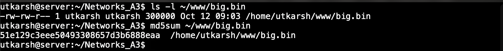

*What it shows:* on the server VM, `big.bin` is 300,000 bytes (more than 100 KB). Its original md5sum is `51e129c3eee50493308657d3b6888eaa`.

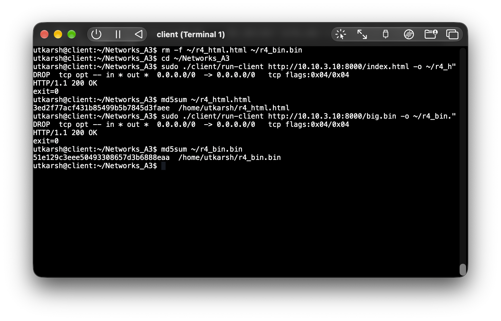

*What it shows:* our client downloads `index.html` and `big.bin`. Both print `HTTP/1.1 200 OK` and exit with code 0. Their md5sums are `3ed2f77a...` (HTML) and `51e129c3...` (binary).

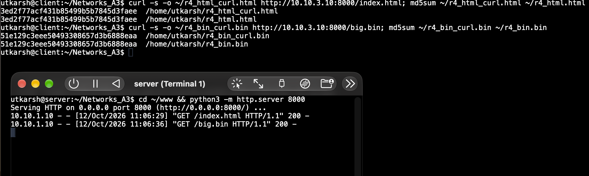

*What it shows:* curl downloads the same two URLs. Each curl md5sum is printed next to ours and they are equal. The server window shows the `GET` requests coming from `10.10.1.10` with status 200.

| Test | Result |
| --- | --- |
| HTML page matches curl | `200 OK`, exit 0, md5 `3ed2f77acf431b85499b5b7845d3faee` for both |
| Binary file matches curl | `200 OK`, exit 0, md5 `51e129c3eee50493308657d3b6888eaa` for both |

### Client error cases

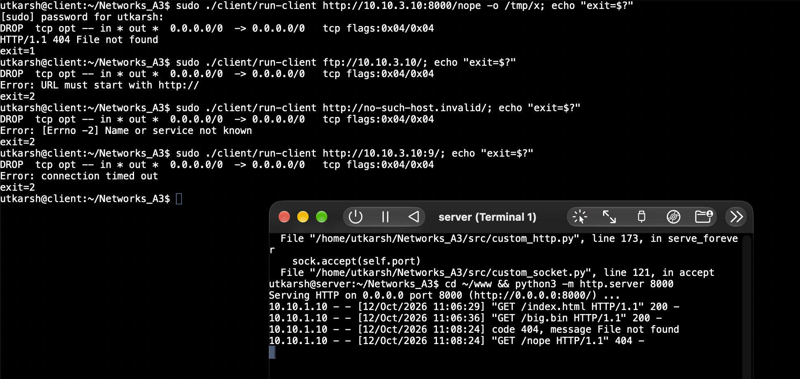

*What it shows:* four error cases and their exit codes.

| Test | Command | Result |
| --- | --- | --- |
| Missing file | `run-client http://10.10.3.10:8000/nope -o /tmp/x` | `HTTP/1.1 404 File not found`, exit 1 (body still saved) |
| Not an http URL | `run-client ftp://10.10.3.10/` | `Error: URL must start with http://`, exit 2 |
| Unknown host | `run-client http://no-such-host.invalid/` | `Error: Name or service not known`, exit 2 |
| Port with no server | `run-client http://10.10.3.10:9/` | `Error: connection timed out`, exit 2 |

For the last test we expected "connection refused". It times out instead because the server VM still had the RST-drop rule from an earlier run of `run-server`, so the server's kernel could not send its RST. The exit code is still 2, as the assignment asks.

### R5: our server against standard clients (Part D)

On the server VM, `sudo ./server/run-server -p 8080 -d ~/www` serves the same `index.html` and `big.bin`.

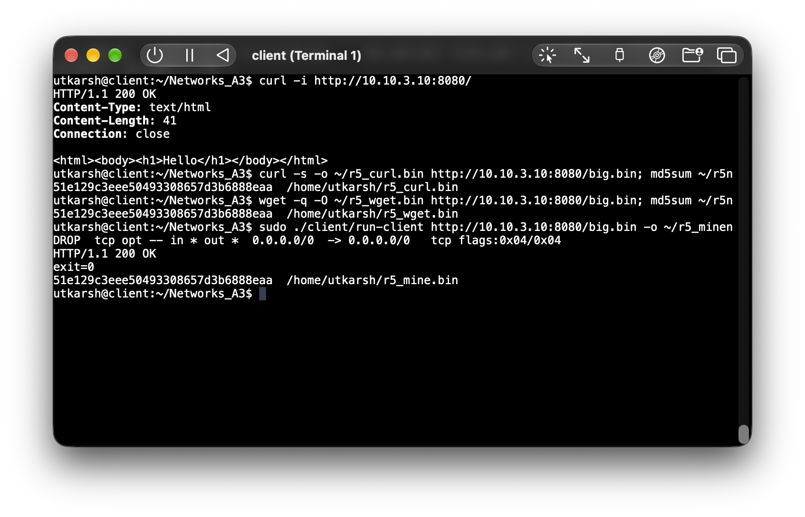

*What it shows:*
- `curl -i http://10.10.3.10:8080/` returns `200 OK` with `Content-Type: text/html`, `Content-Length: 41`, `Connection: close` and the content of `index.html`. So a folder path maps to `index.html`.
- curl, wget and our client all download `big.bin` from our server, and all three md5sums are `51e129c3eee50493308657d3b6888eaa`. This is the md5sum of the original file on the server (shown in R4), so all three match the original.

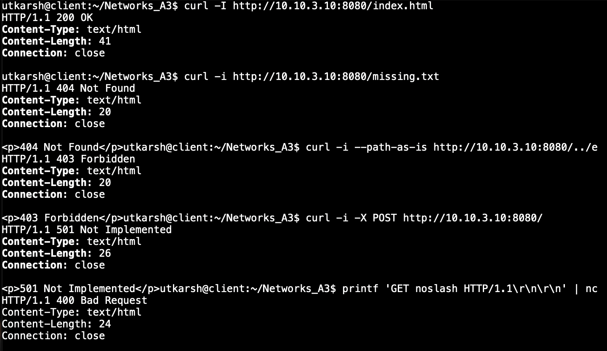

*What it shows:* the response rules, one per command.

| Request | Result |
| --- | --- |
| `curl -I /index.html` (HEAD) | `200 OK`, same headers as GET (`Content-Length: 41`), no body |
| `curl -i /missing.txt` | `404 Not Found` with a small HTML body |
| `curl -i --path-as-is /../e...` | `403 Forbidden` (a path segment is `..`) |
| `curl -i -X POST /` | `501 Not Implemented` |
| `printf 'GET noslash HTTP/1.1\r\n\r\n' \| nc ...` | `400 Bad Request` (target does not start with `/`) |

Every error reply is `HTTP/1.1` and has `Content-Type`, `Content-Length` and `Connection: close`.

### Silent client

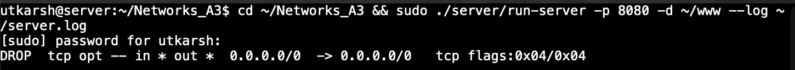

*What it shows:* on the server VM, our server is running on port 8080 with `~/www` as DOCROOT.

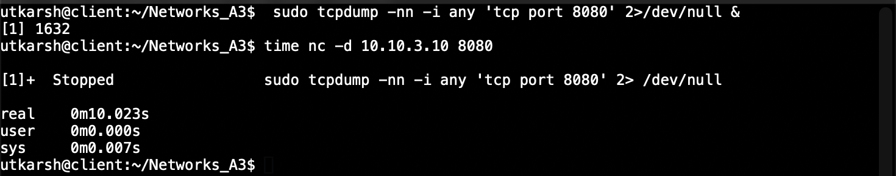

*What it shows:* on the client VM, `nc -d` connects and sends nothing (`-d` stops nc from reading the keyboard, so it exits as soon as the server closes the connection). nc exits after `10.023` seconds. So the server waited 10 seconds for a request head, then closed the connection without sending a reply. Afterwards the server keeps running. (The `Stopped` line is the background `tcpdump` job being paused by the shell; it does not affect the test.)

